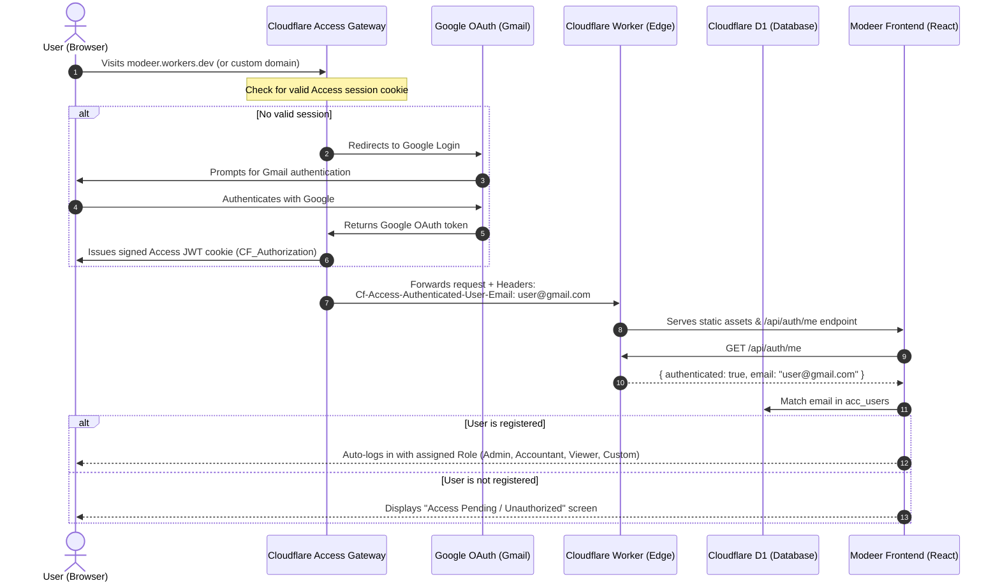

# Cloudflare Zero Trust (Access) & Google Authentication Guide

This document outlines how to protect the **Modeer** application using **Cloudflare Zero Trust (Access)**, link Google/Gmail accounts directly to internal application roles, and eliminate manual usernames and passwords.

---

## 1. Architecture Overview

Currently, Modeer uses local username/password authentication (`acc_users` stored in Cloudflare D1). By integrating Cloudflare Zero Trust, authentication is shifted to Cloudflare's edge using Google OAuth.



---

## 2. Step-by-Step Setup in Cloudflare Dashboard

### Step 1: Initialize Cloudflare Zero Trust
1. Log in to the [Cloudflare Dashboard](https://dash.cloudflare.com).
2. From the left sidebar, click **Zero Trust**.
3. If this is your first time, choose a free team name (e.g., `modeer-corp.cloudflareaccess.com`) and select the **Free Plan** ($0/month for up to 50 users).

---

### Step 2: Configure Google as Identity Provider (IdP)
1. Inside the Zero Trust dashboard, go to **Settings** → **Authentication**.
2. Under **Login methods**, click **Add new**.
3. Select **Google**:
   * **Quick Mode (Recommended):** Use Cloudflare’s built-in Google integration.
   * **Custom Google Cloud Project:** If you want your company’s logo on the Google sign-in consent screen:
     - Create an OAuth 2.0 Client ID in [Google Cloud Console](https://console.cloud.google.com).
     - Add `https://<your-team-name>.cloudflareaccess.com/cdn-cgi/access/callback` as an Authorized Redirect URI.
     - Paste the **Client ID** and **Client Secret** into Cloudflare.
4. Click **Save**.

---

### Step 3: Create an Access Application
1. In the Zero Trust dashboard, navigate to **Access** → **Applications**.
2. Click **Add an Application** → select **Self-Hosted**.
3. Fill in the application settings:
   * **Application name:** `Modeer Accounting`
   * **Session Duration:** Select how often users must re-authenticate (e.g., `24 Hours`, `7 Days`, or `1 Month`).
   * **Application domain:** 
     * Subdomain: `modeer`
     * Domain: `modeer.workers.dev` (or your custom domain, e.g. `modeer.example.com`).
4. Click **Next**.

---

### Step 4: Define Access Policies
1. Add an Access Policy to control who is permitted past the gateway:
   * **Policy name:** `Authorized Staff`
   * **Action:** `Allow`
2. Under **Configure rules**:
   * **Selector:** `Emails` → Enter the authorized Gmail addresses (e.g. `sameh.malek2002@gmail.com`, `accountant@gmail.com`).
   * *(Optional)* If using Google Workspace: **Selector:** `Emails ending in` → `@yourcompany.com`.
3. Click **Next** → **Save Application**.

---

## 3. How the Cloudflare Worker Identifies the User

When a user passes through Cloudflare Access, Cloudflare automatically injects secure, tamper-proof HTTP headers into every request reaching your Worker:

| Header Name | Description | Example |
| :--- | :--- | :--- |
| `Cf-Access-Authenticated-User-Email` | The verified Google/Gmail address | `sameh.malek2002@gmail.com` |
| `Cf-Access-Jwt-Assertion` | Signed JWT containing claims (email, identity provider, expiration) | `eyJhbGciOiJSUzI1NiIs...` |

### Worker Implementation (`src/worker.js`)
A simple endpoint returns the authenticated identity to the frontend:

```javascript
// GET /api/auth/me
if (url.pathname === '/api/auth/me' && request.method === 'GET') {
  const email = request.headers.get('cf-access-authenticated-user-email');
  return jsonResponse({
    authenticated: !!email,
    email: email ? email.toLowerCase() : null,
    provider: email ? 'cloudflare_access' : 'local'
  }, 200, cors);
}
```

---

## 4. Bridging Identity to Modeer Roles & Permissions

In Modeer's data model, each company has a list of users stored in `company_storage` under the key `acc_users`.

### User Record Schema
```json
{
  "id": 1792418343010,
  "name": "Sameh Malek",
  "email": "sameh.malek2002@gmail.com",
  "title": "General Manager",
  "role": "admin",
  "created": 1792418343010
}
```

### Supported Roles & Screen Control
| Role | System Behavior |
| :--- | :--- |
| **`admin`** | Full access to all screens, data import/export, company creation, and user management. |
| **`acct`** (Accountant) | Full edit access to accounting, vouchers, ledger, inventory, payroll, and reports. User management screen is hidden. |
| **`view`** (Viewer / Auditor) | Can view and export all reports, trial balance, and vouchers. All "Save", "Post", "Delete", and "Edit" buttons are disabled. |
| **`custom`** | Granular permissions defined per tab (`''` = hidden, `'v'` = view only, `'e'` = full edit). |

### Frontend Auto-Login Logic (`public/index.html`)
When the app boots:
1. Calls `/api/auth/me`.
2. Reads the verified email.
3. Looks up `users.find(u => (u.email || '').toLowerCase() === email.toLowerCase())`.
4. **If found:** Automatically calls `login(user)` without prompting for passwords or recovery keys.
5. **If not found:** Renders a clean notice:
   > *"Signed in as `someone@gmail.com`. You do not have access to this company. Please contact the administrator to assign a role to your email."*

---

## 5. Limitations & Considerations

### 1. Free Tier Limits
* **50 Users Free:** Cloudflare Zero Trust Free Plan allows up to **50 active users** per month at zero cost.
* Exceeding 50 users requires Cloudflare's paid plan ($7/user/month). For small to mid-sized accounting teams, 50 seats is typically more than sufficient.

### 2. Custom Domain vs `workers.dev`
* **Recommendation:** While Cloudflare Access can protect `workers.dev` URLs, setting up a **custom domain** (e.g. `modeer.yourdomain.com`) is strongly recommended:
  * Avoids third-party cookie restrictions in Safari and Firefox.
  * Ensures seamless Single Sign-On (SSO) persistence across browser tabs and sessions.
  * Allows professional branding on Google login screens.

### 3. API & Webhook Access
* Because Cloudflare Access blocks all unauthenticated HTTP traffic at the perimeter, external automated tools or scripts calling `/api/...` directly will receive an HTTP 302 redirect to Cloudflare login.
* **Workaround:** If external APIs ever need direct access, generate a **Cloudflare Access Service Token** and pass `CF-Access-Client-Id` and `CF-Access-Client-Secret` in request headers.

### 4. Multi-Company Access
* In Modeer, an email can have different roles across different companies (e.g. `user@gmail.com` can be `admin` in Company A, but `view` in Company B).
* Switching companies in the UI seamlessly switches the user's role based on their permissions in that specific company.

### 5. Offline Usage
* Cloudflare Zero Trust requires an active internet connection to verify Google authentication tokens with Cloudflare Edge servers.
* Offline mode cannot initiate a new session while Zero Trust is active.
